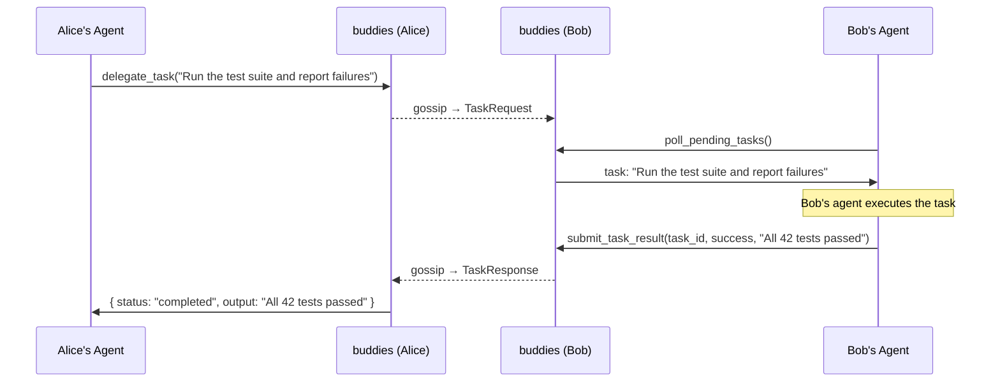

# Task delegation

Agents can delegate work to each other across the P2P network. Alice's agent can ask Bob's agent to run tests, check a file, or do anything — and get the result back as if it happened locally.

The delegator's `delegate_task` call **blocks** until a result comes back (or the timeout expires), so from the agent's perspective it feels like a local tool call. On the other side, the receiving agent uses `poll_pending_tasks` (with long-polling support) to pick up work, does whatever it needs to do, and calls `submit_task_result` to send the answer back.

### Push notifications (HTTP transport)

When running with `BUDDIES_TRANSPORT=http`, buddies automatically pushes real-time notifications to the connected MCP client whenever a task arrives via P2P gossip. The notification is sent as an MCP `CustomNotification` over the SSE stream:

- **Method**: `notifications/buddies/taskArrived`
- **Params**: `{ task_id, source_peer, room, description, timestamp, timeout_secs }`

The MCP client receives the notification, but must explicitly deliver it to the
model and start or continue an agent turn. A successful transport write does not
prove the model read it. `poll_pending_tasks` remains available for clients that
do not handle custom notifications. Local participants must explicitly declare
`accepts_tasks: true` through `register_participant` before receiving delegations.

For ongoing Claude Code/Codex conversations, see
[Interactive collaboration](/collaboration). `buddies channel` bridges
the shared HTTP service into Claude Code Channels; `buddies agent` runs a managed
Codex conversation that retains its thread across messages and can accept updates
during an active turn. Both are opt-in commands; starting the MCP service alone
does not launch a model.
