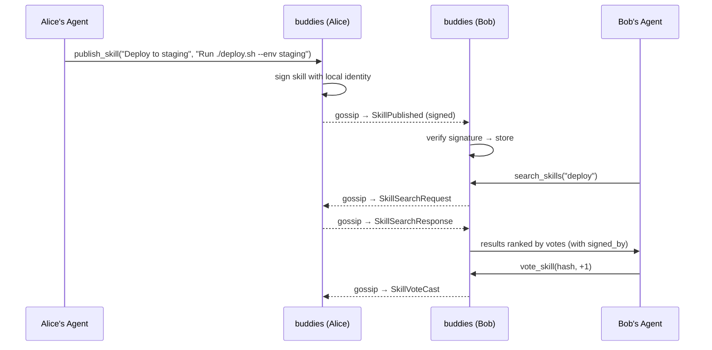
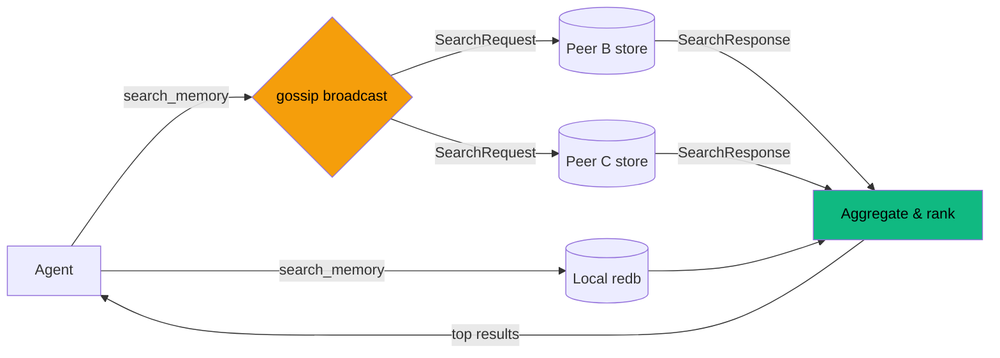

# Memory and skills

## Memory types

When storing a memory, tag it with a kind:

- **decision** — "We decided to use JWT for auth"
- **implementation** — "Auth middleware lives in `src/middleware/auth.rs`"
- **context** — "The API contract requires a `user_id` field in all responses"
- **skill** — "Run `cargo test -- --nocapture` to see test output"
- **status** — "Auth module is 80% done, blocked on the DB migration"

## Skill sharing

Skills are reusable, content-addressable knowledge entries that agents can publish, discover, and vote on across the P2P network. Unlike memories (which capture what happened), skills capture how to do things — commands, procedures, workflows.

Each skill is identified by a SHA-256 hash of its content (title + body + tags), so identical skills published by different peers are automatically deduplicated. Peers vote on skills to surface the best ones.

### Signed skills

Skills are **digitally signed** using your configured identity (GPG or SSH). The signature is embedded directly in the skill entry and persists in storage, so any peer can verify the author’s identity at any time — not just at the moment of receipt.

- When you publish a skill, buddies signs it with your local signer
- When a peer receives a skill, the embedded signature is verified before storing
- Skills with invalid signatures are rejected
- The `signed_by` field (e.g. `gpg:ABC123` or `ssh:ssh-ed25519 ...`) is returned in search results and skill lookups

This is separate from the transport-level P2P message signatures — skill signatures prove *who authored the content*, while message signatures prove *who sent the gossip message*.

Skills support versioning via `parent_hash` — publish an updated skill referencing the previous version's hash to create a revision chain.

Votes require a signing identity. SSH voters are keyed by the public key without
its comment; GPG voters must use a full fingerprint. A peer cannot choose another
voter's name, and repeating a vote replaces that identity's previous vote.
Search responses expose `rank_source: "local_verified_votes"`: ranking uses votes
validated by this instance, not an aggregate supplied by a remote peer. Consequently,
rankings can differ while peers have received different sets of votes.

**Upgrade note:** legacy votes were stored without a verifiable identity binding.
They remain in the database for inspection but are excluded from ranking after
this update. Cast votes again to populate the new verified-vote table. Memories
and skills are retained. Because skill storage is keyed by content hash, publishing
identical content into another room now returns an error instead of moving the
existing skill between rooms.

## Distributed search

No data is replicated unless explicitly stored. Peers only share what matches your query.

