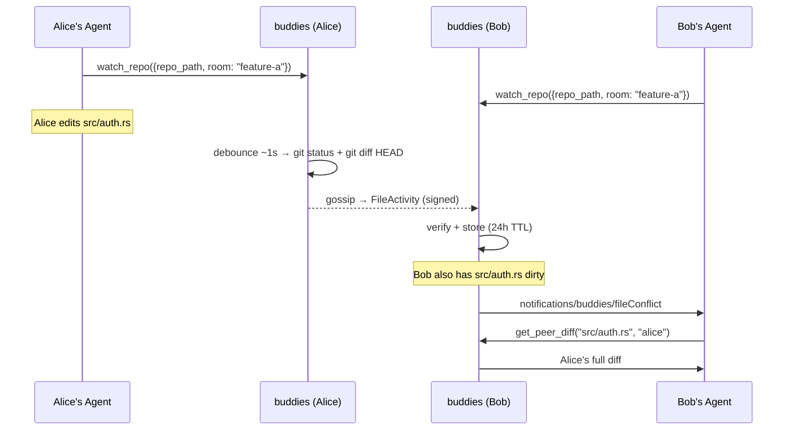

# Repository awareness

`watch_repo({repo_path, room, repo_name?})` starts a filesystem watcher on a local git repository. Join the room first. File-change events are debounced by roughly 1 second and then buddies shells out to `git` to determine what actually changed, so `.gitignore`'d files and build artifacts never get broadcast. Git does the filtering for you.

The watcher ignores read-only access events and `.git` metadata churn. It also reconciles against Git every 2 seconds, which clears stale dirty state after a commit even if the filesystem notification was missed. If a Git command or file read fails, that scan is skipped and the last known state is retained rather than broadcasting an empty or misleading update.

Each changed file is broadcast to the room as a `FileActivity` message carrying a unified diff against `HEAD`, capped at 64 KiB. The message is signed when a local signer is configured. Receivers bind the activity's `author` to the identity that joined under that peer name; a different signer cannot publish activity, status updates, or leave messages as that peer. Receivers keep only the latest diff per `(repo, file, peer)` triple, and entries expire after 24 hours.

- **check_file_activity** should be called before editing a file in a shared repo, to see which peers have touched it recently.
- **get_peer_diff** returns a peer's full diff for a specific file so you can review exactly what changed.
- When a peer changes a file you've also modified locally, buddies proactively pushes a `notifications/buddies/fileConflict` `CustomNotification` with instructions to reconcile before you continue editing. Its payload includes the repo/path plus branch, change kind, timestamp, and added/removed line counts for both the peer change and the nested `local` change.
- Watching the same canonical repo path twice is idempotent. The response reports the repo name and room of the watcher that is actually active; call `unwatch_repo` before moving that path to another room.

Git remains the source of truth — buddies never writes to your working tree. Only uncommitted changes are broadcast, watchers stop when the process exits, and late joiners see activity from the moment they join, not before.

**Privacy warning**: watching a repo shares source-code diffs with everyone in the room. Only watch repos in rooms with `require_signed=true` and an identity whitelist configured (see [Identity trust model](/reference/identity)).
