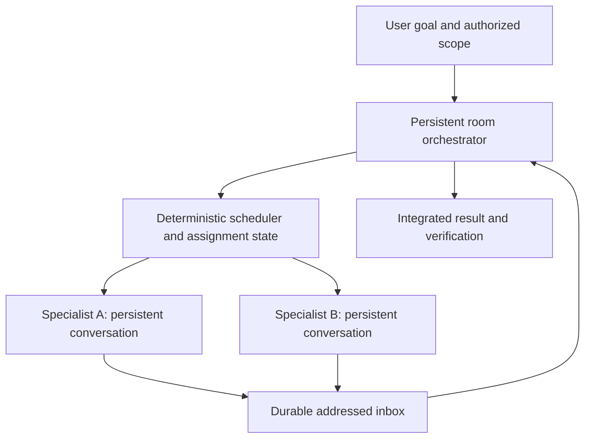

# A room orchestrator

The next implementation increment described here is now available through
`buddies orchestrator`. See [usage, assignment protocol and recovery](orchestrator.md).
The baseline implementation section below describes the primitives on which the
command was built. A deterministic producer/consumer experiment covers the
runtime protocol; a real-model comparison with direct peer coordination remains
an opt-in experiment.

## Recommendation

Use one opt-in, persistent orchestrator per room. It owns the goal, dependencies,
assignments and integration of results. Specialist agents own bounded tasks and
keep their execution context. The message/inbox runtime is the foundation, but
there is no automatic model launch when the buddies service starts.

An orchestrator is useful when work depends on several results or requirements
change during execution. Two agents with a clear shared contract can coordinate
directly. Adding a model to every status event would increase cost and contention
without ensuring better decisions.

## Execution model

Separate the scheduler's deterministic responsibilities from the model's choices.
The scheduler stores assignment IDs, owner, revision, dependency, deadline and
state, and enforces concurrency and resource budgets. The model decides how to
break down the goal, resolves ambiguity and proposes assignment changes.

Keep `queued`, `running`, `waiting_for_input`, `completed`, `failed` and `cancelled`
as assignment states. Message `handled` means processed, not assignment completed.
Results must identify the assignment revision they satisfy. A result from an old
revision is retained as evidence and does not satisfy a newer requirement.

When new information arrives:

| Event | Orchestrator action |
| --- | --- |
| Question or blocker | Supply context or ask the responsible agent/user; resume the same assignment. |
| Requirement change | Increment the affected assignment revision, send an addressed update and require acceptance. |
| Partial/result message | Validate evidence, update dependencies and release ready assignments. |
| Status/heartbeat | Update stored state; invoke the model only if a meaningful decision is needed. |
| Executor disappearance | Mark execution uncertain; inspect effects before retrying. |

An update can steer an active managed Codex turn. For a material scope change,
ask for a checkpoint before replacing/cancelling work. Steering does not undo
commands or file changes already performed. An agent spawned for a new task
receives the goal, assignment, authorized paths, relevant decisions and completion
criteria. Existing specialists receive the delta plus its revision.

## What the current implementation provides

- Stable participant names and a durable question/answer inbox with receipts.
- A managed Codex thread that receives subsequent messages and supports steering.
- A Claude Code Channel bridge for interactive reception.
- Existing automatic workers with durable task queues and outcomes.

The managed agent can coordinate through addressed messages and submit bounded
background worker tasks. These primitives allow experiments with an agent named
`orchestrator`, given a concrete coordination task by the user. They do not yet
provide a production orchestrator's assignment graph, revision acceptance,
automatic specialist spawning, aggregate budget or verified result integration.
Existing one-shot worker tasks have no live steering interface; use persistent
specialist conversations for tasks that need ongoing negotiation.

## Next implementation increment

Add an explicit `buddies orchestrator` command with a room, repository, model,
goal, authorized paths and maximum active specialists. Start from a persisted
assignment graph and two specialist roles. Keep a stable conversation/thread ID
per specialist and reuse it for clarification and requirement updates. Create a
new specialist only when the task needs another independent responsibility.

Use separate worktrees for concurrent writes and require explicit ownership of
shared contracts. The orchestrator integrates changes after the acceptance checks
pass. If the client is busy, queue messages by default; reserve steering for input
that affects current work. Debounce bursts and summarize relevant changes before
invoking the model. Bound model calls, output, elapsed time and recursion depth.
The ordinary transport service remains usable without starting any model.

## Acceptance experiment

Give two specialists a producer/consumer task with an intentionally missing field.
Then change the contract while one specialist is active. Compare direct peer
coordination with orchestrated coordination using the same models and task.

Success requires all of the following:

- The ambiguity is resolved through a recorded question and answer.
- The affected specialist accepts the new assignment revision.
- Its result implements the revised contract and passes the shared check.
- Unaffected work continues without unnecessary restart.
- No human relays messages, no duplicate execution occurs, and costs/latency fit
  the configured budget.

Use this experiment to decide whether the extra orchestrator improves completion
rate and recovery, rather than counting how often agents talk.
