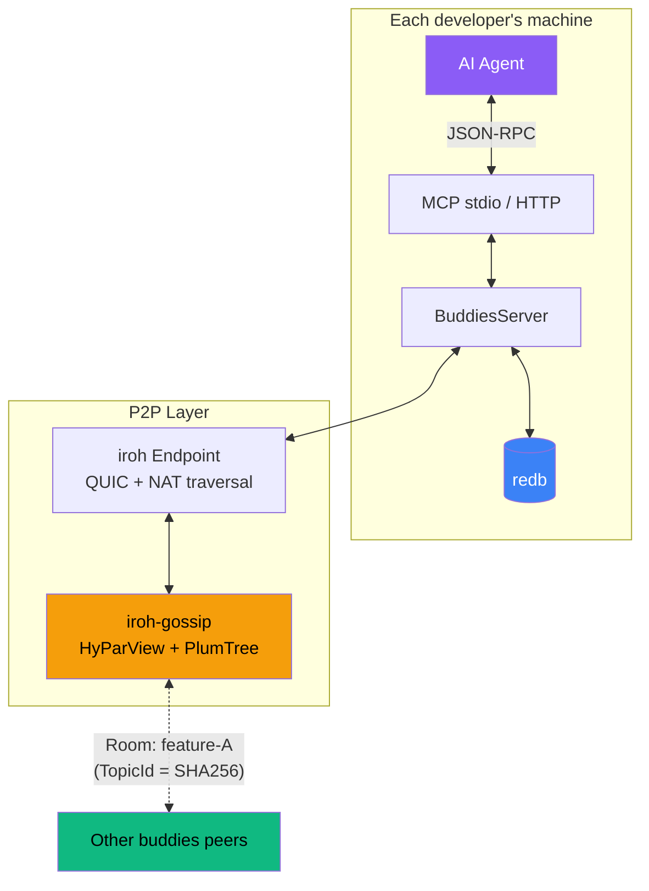

# Architecture

- **Transport**: MCP over stdio (default) or streamable HTTP — stdio for clients that spawn the process, HTTP for standalone deployment
- **MCP**: [rmcp](https://github.com/modelcontextprotocol/rust-sdk) 3.x — server tools over stdio or streamable HTTP
- **Networking**: [Iroh](https://iroh.computer) 1.x — QUIC connections with NAT hole-punching and relay fallback
- **Gossip**: [iroh-gossip](https://github.com/n0-computer/iroh-gossip) 0.101.x — epidemic broadcast trees (HyParView + PlumTree)
- **Storage**: [redb](https://github.com/cberner/redb) 4.x — embedded key-value store, single file, zero config
- **Hashing**: [sha2](https://github.com/RustCrypto/hashes) 0.11.x — room topics and content fingerprints
- **Wire format**: [postcard](https://github.com/jamesmunns/postcard) — compact binary serialization for gossip messages

Rooms map to gossip topics via deterministic SHA-256 hashing. Same room name = same topic = same swarm. Peers discover each other through Iroh's relay infrastructure and direct QUIC hole-punching.

## Persistent orchestration

The [orchestrator](/orchestrator) coordinates participants on one HTTP service. Its scheduler persists assignments, revisions, thread IDs and verification evidence under the repository common git directory. Specialists work in detached worktrees; only verified results release dependencies and the shared acceptance checks gate publication to the original checkout.
